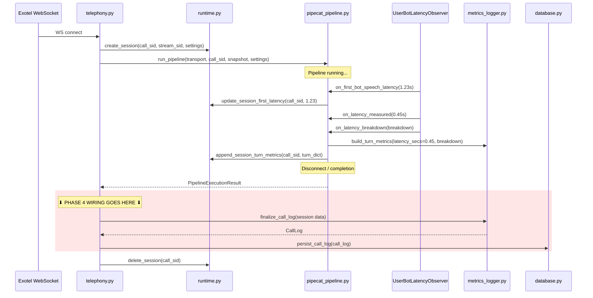

# Phase 3 → Phase 4 Handoff Document

## Purpose

This document gives a complete, accurate picture of the repository as of Phase 3 completion. Read this before starting Phase 4 to avoid rediscovery and inconsistency.

Read together with:
- [PHASE_4_INTEGRATION.md](file:///c:/NovaAutomata_Internship/VoiceAgent_Pipecat/PHASE_4_INTEGRATION.md)
- [AGENTS.md](file:///c:/NovaAutomata_Internship/VoiceAgent_Pipecat/AGENTS.md)
- [TECHNICAL_PLAN.md](file:///c:/NovaAutomata_Internship/VoiceAgent_Pipecat/TECHNICAL_PLAN.md)
- [NOTES.md](file:///c:/NovaAutomata_Internship/VoiceAgent_Pipecat/NOTES.md)

---

## Code Review Summary

10 issues were found and fixed. All fixes verified green.

| # | Severity | File | Issue | Resolution |
|---|----------|------|-------|------------|
| 1 | Doc Stale | TECHNICAL_PLAN.md | "Open Items" still referenced unimplemented schemas | ✅ Marked as resolved |
| 2 | Doc Stale | models/\_\_init\_\_.py | Docstring said "later schema definitions" | ✅ Updated |
| 3 | Doc Stale | PHASE_1_IMPLEMENTATION_NOTES.md | Phase 1 stub behavior described as current | ⚪ Left as historical record |
| 4 | Consistency | .env.example | `MONGO_DB_NAME=voice_agent_local` vs user's Atlas requirement | ✅ Changed to `voice_agent_dev` |
| 5 | Consistency | telephony.py:128 | Comment said "Phase 3 placeholder" — Phase 3 is done | ✅ Updated to "Phase 4 wiring pending" |
| 6 | Consistency | telephony.py:144 | Same stale comment on disconnect path | ✅ Updated |
| 7 | Bug Risk | database.py:42 | Fragile URI host parsing that breaks on Atlas `mongodb+srv://` URIs | ✅ Removed, logs database name only |
| 8 | Style | pipecat_pipeline.py:1 | Docstring denied session registry writes, but Phase 3 callbacks write to it | ✅ Updated docstring |
| 9 | Consistency | NOTES.md:9 | Open question about persistence shape still unresolved | ✅ Marked as resolved |
| 10 | Missing | .gitignore | `logs/` directory not excluded from version control | ✅ Added `logs/` to .gitignore |

---

## Complete Repo File Inventory

### Project Root

| File | Role | Phase |
|------|------|-------|
| [main.py](file:///c:/NovaAutomata_Internship/VoiceAgent_Pipecat/main.py) | FastAPI app factory + lifespan (logging init → DB init → yield → DB close) | P0 created, P3 added lifespan |
| [.env.example](file:///c:/NovaAutomata_Internship/VoiceAgent_Pipecat/.env.example) | Template for local `.env` | P0 created, P3 updated `MONGO_DB_NAME` |
| [.gitignore](file:///c:/NovaAutomata_Internship/VoiceAgent_Pipecat/.gitignore) | Git exclusions | P0 created, P3 added `logs/` |
| [pyproject.toml](file:///c:/NovaAutomata_Internship/VoiceAgent_Pipecat/pyproject.toml) | Dependencies: pipecat-ai[silero,exotel], motor, deepgram-sdk, etc. | P0 |

### App Package

| File | Role | Key Exports |
|------|------|-------------|
| [app/config.py](file:///c:/NovaAutomata_Internship/VoiceAgent_Pipecat/app/config.py) | Pydantic `Settings` + `get_settings()` + `V1_SAMPLE_RATE = 16000` | `Settings`, `get_settings`, `V1_SAMPLE_RATE` |
| [app/runtime.py](file:///c:/NovaAutomata_Internship/VoiceAgent_Pipecat/app/runtime.py) | Session registry + helpers | `ACTIVE_SESSIONS`, `create_session`, `get_session`, `delete_session`, `update_session_first_latency`, `append_session_turn_metrics`, `ConfigSnapshot`, `RuntimeSession` |
| [app/database.py](file:///c:/NovaAutomata_Internship/VoiceAgent_Pipecat/app/database.py) | Motor MongoDB singleton | `init_database`, `get_database`, `persist_call_log`, `close_database`, `CALL_LOGS_COLLECTION` |
| [app/logging_config.py](file:///c:/NovaAutomata_Internship/VoiceAgent_Pipecat/app/logging_config.py) | Loguru dual-sink setup | `setup_logging` |

### Routers

| File | Route | Role |
|------|-------|------|
| [app/routers/telephony.py](file:///c:/NovaAutomata_Internship/VoiceAgent_Pipecat/app/routers/telephony.py) | `WS /telephony/exotel` | WebSocket accept → identity → session → transport → pipeline → finalization boundary → cleanup |

### Services

| File | Role | Key Exports |
|------|------|-------------|
| [app/services/transport_factory.py](file:///c:/NovaAutomata_Internship/VoiceAgent_Pipecat/app/services/transport_factory.py) | Exotel transport construction at 16kHz | `build_exotel_transport` |
| [app/services/pipecat_pipeline.py](file:///c:/NovaAutomata_Internship/VoiceAgent_Pipecat/app/services/pipecat_pipeline.py) | Pipeline assembly + execution + observer callbacks | `run_pipeline`, `PipelineExecutionResult` |

### Models

| File | Role | Key Exports |
|------|------|-------------|
| [app/models/schemas.py](file:///c:/NovaAutomata_Internship/VoiceAgent_Pipecat/app/models/schemas.py) | Pydantic persistence schemas | `LatencyEvent`, `TurnMetrics`, `CallMetrics`, `CallLog` |

### Utils

| File | Role | Key Exports |
|------|------|-------------|
| [app/utils/metrics_logger.py](file:///c:/NovaAutomata_Internship/VoiceAgent_Pipecat/app/utils/metrics_logger.py) | Latency normalization + call finalization | `normalize_latency_breakdown`, `build_turn_metrics`, `finalize_call_log` |

---

## Data Flow Through The System



---

## Current Runtime Session Shape

Created by `create_session()` in [runtime.py](file:///c:/NovaAutomata_Internship/VoiceAgent_Pipecat/app/runtime.py#L49):

```python
{
    "call_sid": "exotel_call_id_123",
    "stream_sid": "exotel_stream_id_456",
    "metrics": {
        # Populated by observer callbacks during the call:
        "first_bot_speech_latency_secs": 1.23,        # set once
        "turn_count": 2,                               # incremented per turn
        "turns": [                                     # appended per turn
            {
                "user_bot_latency_secs": 0.45,
                "latency_events": [
                    {"time": 1716900000.0, "event": "User turn: 0.500s"},
                    {"time": 1716900000.6, "event": "DeepgramSTT: TTFB 0.045s"},
                    {"time": 1716900000.7, "event": "CerebrasLLM: TTFB 0.120s"},
                ]
            }
        ]
    },
    "transcript": [],          # NOT populated in Phase 3
    "first_latency": 1.23,     # set once by update_session_first_latency()
    "config_snapshot": {
        "SYSTEM_PROMPT": "...",
        "LLM_MODEL": "llama3.1-70b",
        "LLM_TEMPERATURE": 0.7,
        "TTS_VOICE_ID": "8262a63b-...",
        "TTS_MODEL": "sonic-english",
        "INITIAL_GREETING_PROMPT": "...",
        "SAMPLE_RATE": 16000,
    }
}
```

> [!IMPORTANT]
> `metrics` is a **mutable dict** updated in-place by observer callbacks during the call. Everything inside it is serializable (dicts, lists, floats, strings). No Pipecat objects are stored.

---

## MongoDB Document Shape

The `CallLog` Pydantic model in [schemas.py](file:///c:/NovaAutomata_Internship/VoiceAgent_Pipecat/app/models/schemas.py) defines the MongoDB document:

```python
{
    "call_sid": "exotel_call_id_123",
    "stream_sid": "exotel_stream_id_456",
    "config_snapshot": { ... },            # frozen at call start
    "metrics": {
        "first_bot_speech_latency_secs": 1.23,
        "turn_count": 2,
        "turns": [
            {
                "user_bot_latency_secs": 0.45,
                "latency_events": [
                    {"time": 1716900000.0, "event": "User turn: 0.500s"},
                    ...
                ]
            }
        ]
    },
    "completed": true,
    "error": null
}
```

- Collection: `call_logs`
- Database: configured via `MONGO_DB_NAME` env var (recommended: `voice_agent_dev`)
- Auto-created on first insert

---

## Boundaries That Must Not Change

| Boundary | Where | Status |
|----------|-------|--------|
| `ACTIVE_SESSIONS` ownership | `app/runtime.py` | ✅ Sole owner |
| No live objects in sessions | All phases | ✅ Enforced |
| Observer on `PipelineTask` | `pipecat_pipeline.py:215` | ✅ Correct position |
| `SileroVADAnalyzer` in `LLMUserAggregatorParams` | `pipecat_pipeline.py:121` | ✅ Present |
| Sample rate 16kHz | `app/config.py:V1_SAMPLE_RATE` | ✅ Fixed |
| Route path | `WS /telephony/exotel` | ✅ Unchanged |
| Teardown order | cancel → unwind → finalize → cleanup | ✅ Structural boundaries exist |
| Config snapshot immutability | `create_session()` → `config_snapshot` | ✅ Immutable per call |
| `call_sid` / `stream_sid` naming | Everywhere | ✅ Consistent |

---

## What Phase 4 Must Do

Per [PHASE_4_INTEGRATION.md](file:///c:/NovaAutomata_Internship/VoiceAgent_Pipecat/PHASE_4_INTEGRATION.md), the integration phase wires the existing subsystems together:

### 1. Wire Finalization Into Telephony Route

The two finalization boundaries in [telephony.py](file:///c:/NovaAutomata_Internship/VoiceAgent_Pipecat/app/routers/telephony.py) need to call `finalize_call_log()` + `persist_call_log()`:

**Normal completion boundary** (line ~128):
```python
# REPLACE the placeholder log with:
call_log = finalize_call_log(
    call_sid=call_sid,
    stream_sid=stream_sid,
    config_snapshot=session["config_snapshot"],
    metrics=session["metrics"],
    completed=result.completed,
    error=result.error,
)
await persist_call_log(call_log)
```

**Pre-pipeline disconnect boundary** (line ~142):
```python
# REPLACE the placeholder log with:
session = get_session(created_call_sid)
if session:
    call_log = finalize_call_log(
        call_sid=created_call_sid,
        stream_sid=session["stream_sid"],
        config_snapshot=session["config_snapshot"],
        metrics=session["metrics"],
        completed=False,
        error="pre_pipeline_disconnect",
    )
    await persist_call_log(call_log)
```

**New imports needed:**
```python
from app.runtime import create_session, delete_session, get_session
from app.utils.metrics_logger import finalize_call_log
from app.database import persist_call_log
```

### 2. Handle `config_snapshot` → `INITIAL_GREETING_PROMPT`

The Phase 4 acceptance criteria mention: "At call start, `session['config_snapshot']` contains exactly `SYSTEM_PROMPT`, `LLM_MODEL`, `LLM_TEMPERATURE`, `TTS_VOICE_ID`, `TTS_MODEL`, and `SAMPLE_RATE`."

Note: `INITIAL_GREETING_PROMPT` **is** already in the snapshot (added in Phase 1 per `PHASE_2_PIPELINE_FLOW.md` requirement). The Phase 4 checklist item may be an older draft that predates the greeting field. Verify whether the checklist needs updating or if the snapshot should be trimmed.

### 3. Dashboard / Config Route (Optional)

Phase 4 allows a `app/routers/dashboard.py` for config inspection. Key constraints:
- Must not mutate `ACTIVE_SESSIONS` or any running session's `config_snapshot`
- Changes to config only affect **future** calls
- Keep the route boundary thin

### 4. Error Path Coverage

Currently, the `except Exception` block in [telephony.py:146](file:///c:/NovaAutomata_Internship/VoiceAgent_Pipecat/app/routers/telephony.py#L146) logs the error but does **not** call finalization. Phase 4 should decide: should unexpected errors also produce a `CallLog` (with `completed=False, error="unexpected_error"`) or just be dropped?

### 5. Verify Teardown Order

Phase 4 must confirm the structural ordering:
1. `WebSocketDisconnect` caught (or pipeline returns normally)
2. `task.cancel()` + runner unwind (handled inside `run_pipeline()`)
3. `finalize_call_log()` called (NEW in Phase 4)
4. `persist_call_log()` called (NEW in Phase 4)
5. `delete_session()` in `finally` block (existing)

---

## Phase 4 Allowed Files

| File | Expected Changes |
|------|-----------------|
| `app/routers/telephony.py` | Wire finalization + persistence at both boundaries |
| `app/routers/dashboard.py` | NEW — optional config inspection route |
| `app/services/pipecat_pipeline.py` | No changes expected unless integration reveals issues |
| `app/utils/metrics_logger.py` | No changes expected |
| `app/config.py` | May need config-reload helpers for dashboard |
| `app/runtime.py` | May need narrow dashboard-safe helpers |
| `main.py` | Mount dashboard router if created |

---

## Verification Status Through Phase 3

All of the following pass as of Phase 3 completion:

- ✅ Schema instantiation (LatencyEvent, TurnMetrics, CallMetrics, CallLog)
- ✅ CallLog round-trip (model_dump → constructor)
- ✅ JSON serialization (MongoDB-safe)
- ✅ Latency normalization (correct shape, sorted, handles empty)
- ✅ build_turn_metrics (with and without breakdown)
- ✅ finalize_call_log (normal + disconnect cases)
- ✅ Runtime session helpers (first_latency once-only, turn append, missing-session guard)
- ✅ Logging config (setup + call_sid binding)
- ✅ Full app import chain (main → all modules)
- ✅ Route registration (/telephony/exotel)
- ✅ All documentation consistent (no stale references)
