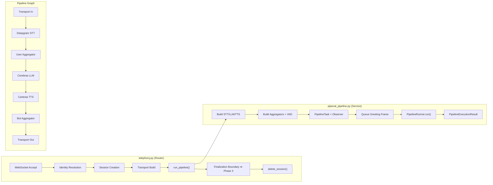

# Phase 2 → Phase 3 Handoff Document

**Date:** 2026-05-27  
**Status:** Phase 2 DONE, Phase 3 ready to begin  
**Phase gate satisfied:** `PHASE_PROGRESS.md` has Phase 2 = `DONE`, Phase 3 = `NOT STARTED`

---

## What Was Built in Phase 2

Phase 2 replaced the Phase 1 WebSocket bootstrap stub (`1000` close) with a fully wired Pipecat STT → LLM → TTS pipeline. The implementation preserves all Phase 0/1 boundaries.

### Files Created

| File | Purpose |
|------|---------|
| [app/services/pipecat_pipeline.py](file:///c:/NovaAutomata_Internship/VoiceAgent_Pipecat/app/services/pipecat_pipeline.py) | Pipeline service — assembles Deepgram STT, Cerebras LLM, Cartesia TTS, VAD, mute strategies, observer. Single entry point: `run_pipeline()` |

### Files Modified

| File | What Changed |
|------|-------------|
| [app/config.py](file:///c:/NovaAutomata_Internship/VoiceAgent_Pipecat/app/config.py) | Added `initial_greeting_prompt` field to `Settings` |
| [app/runtime.py](file:///c:/NovaAutomata_Internship/VoiceAgent_Pipecat/app/runtime.py) | Added `INITIAL_GREETING_PROMPT` to `ConfigSnapshot` (now 7-field) and `build_config_snapshot()` |
| [app/services/transport_factory.py](file:///c:/NovaAutomata_Internship/VoiceAgent_Pipecat/app/services/transport_factory.py) | Added `audio_in_enabled=True`, `audio_out_enabled=True`, `audio_in/out_sample_rate=16000` |
| [app/routers/telephony.py](file:///c:/NovaAutomata_Internship/VoiceAgent_Pipecat/app/routers/telephony.py) | Replaced Phase 1 `1000` close with `run_pipeline()` call. Added Phase 3 finalization boundary comments |
| [.env.example](file:///c:/NovaAutomata_Internship/VoiceAgent_Pipecat/.env.example) | Added `INITIAL_GREETING_PROMPT` |
| [TECHNICAL_PLAN.md](file:///c:/NovaAutomata_Internship/VoiceAgent_Pipecat/TECHNICAL_PLAN.md) | Updated snapshot shape to include `INITIAL_GREETING_PROMPT` |
| [PHASE_2_PIPELINE.md](file:///c:/NovaAutomata_Internship/VoiceAgent_Pipecat/PHASE_2_PIPELINE.md) | All checklist items marked `[x]` |
| [PHASE_2_PIPELINE_FLOW.md](file:///c:/NovaAutomata_Internship/VoiceAgent_Pipecat/PHASE_2_PIPELINE_FLOW.md) | Added `INITIAL_GREETING_PROMPT` to inherited inputs and resolved questions |
| [PHASE_2_STATE_MACHINE.md](file:///c:/NovaAutomata_Internship/VoiceAgent_Pipecat/PHASE_2_STATE_MACHINE.md) | Added `INITIAL_GREETING_PROMPT` to `pipeline_ready` preconditions |
| [PHASE_2_BREAKDOWN.md](file:///c:/NovaAutomata_Internship/VoiceAgent_Pipecat/PHASE_2_BREAKDOWN.md) | Added `INITIAL_GREETING_PROMPT` to 2C + verified Settings pattern |
| [PHASE_1_IMPLEMENTATION_NOTES.md](file:///c:/NovaAutomata_Internship/VoiceAgent_Pipecat/PHASE_1_IMPLEMENTATION_NOTES.md) | Updated config_snapshot example shape to 7-field |
| [NOTES.md](file:///c:/NovaAutomata_Internship/VoiceAgent_Pipecat/NOTES.md) | Recorded all verified Pipecat 1.2.1 patterns + snapshot shape fix |
| [PHASE_PROGRESS.md](file:///c:/NovaAutomata_Internship/VoiceAgent_Pipecat/PHASE_PROGRESS.md) | Phase 2 marked `DONE` |

### Files Deleted

| File | Reason |
|------|--------|
| `Implementation PLan for Phase 2.md` | Was an ad-hoc implementation plan — all content is now reflected in the phase spec docs |

---

## Architecture Overview



---

## Verified Pipecat 1.2.1 API Patterns

These are confirmed against the installed venv and recorded in [NOTES.md](file:///c:/NovaAutomata_Internship/VoiceAgent_Pipecat/NOTES.md):

| Service | Constructor Pattern | Notes |
|---------|-------------------|-------|
| `DeepgramSTTService` | `api_key=, sample_rate=16000, settings=DeepgramSTTSettings(language="en")` | **No `.InputParams` class exists** — using it crashes at runtime |
| `CerebrasLLMService` | `api_key=, settings=CerebrasLLMSettings(model=..., temperature=...)` | `.Settings` and `.InputParams` are different classes |
| `CartesiaTTSService` | `api_key=, sample_rate=16000, settings=CartesiaTTSSettings(voice=..., model=...)` | `voice_id=` and `model=` as direct kwargs are **deprecated** (emit `DeprecationWarning`) |

---

## Review Passes Completed

Two full review passes were conducted and all issues resolved:

### Review Pass 1 (4 issues found, fixed)
1. **Deepgram `InputParams` crash** — `DeepgramSTTService.InputParams` doesn't exist → replaced with `sample_rate=` + `DeepgramSTTSettings()`
2. **Cartesia deprecated kwargs** — `voice_id=`, `model=` → moved to `CartesiaTTSSettings(voice=..., model=...)`
3. **Dead imports/constants** — Removed `get_session` import and `NORMAL_CLOSURE_CODE = 1000` from router
4. **Doc alignment** — Added `INITIAL_GREETING_PROMPT` to `TECHNICAL_PLAN.md`, `PHASE_2_PIPELINE_FLOW.md`, `PHASE_2_STATE_MACHINE.md`, `PHASE_2_BREAKDOWN.md`

### Review Pass 2 (4 issues found, fixed)
1. **Module docstring stale** — Pipeline module docstring still said `voice_id=` → fixed
2. **NOTES.md stale snapshot** — Line 31 listed 6-field snapshot → fixed to 7-field
3. **PHASE_2_PIPELINE.md unchecked items** — "Later Implementation" checklist still unchecked → all marked `[x]`
4. **PHASE_1_IMPLEMENTATION_NOTES.md stale snapshot** — Example showed 6-field snapshot → fixed to 7-field

---

## ConfigSnapshot Shape (7 Fields)

```python
class ConfigSnapshot(TypedDict):
    SYSTEM_PROMPT: str
    LLM_MODEL: str
    LLM_TEMPERATURE: float
    TTS_VOICE_ID: str
    TTS_MODEL: str
    INITIAL_GREETING_PROMPT: str
    SAMPLE_RATE: int              # Always 16000 in v1
```

This shape is now consistent across: `app/runtime.py`, `TECHNICAL_PLAN.md`, `NOTES.md`, `PHASE_1_IMPLEMENTATION_NOTES.md`, `PHASE_2_PIPELINE_FLOW.md`.

---

## Phase 3 Integration Points

### Finalization Boundaries

Phase 3 (`finalize_call_log()`) attaches at two documented boundary points in [telephony.py](file:///c:/NovaAutomata_Internship/VoiceAgent_Pipecat/app/routers/telephony.py):

1. **Normal pipeline completion** — [line 128](file:///c:/NovaAutomata_Internship/VoiceAgent_Pipecat/app/routers/telephony.py#L128-L132):
   ```python
   # --- Phase 3 finalization boundary ---
   # finalize_call_log() will be implemented in Phase 3.
   log.info("Finalization boundary reached (Phase 3 placeholder)")
   ```

2. **Pre-pipeline disconnect** — [line 144](file:///c:/NovaAutomata_Internship/VoiceAgent_Pipecat/app/routers/telephony.py#L144-L145):
   ```python
   # --- Phase 3 finalization boundary ---
   log.info("Finalization boundary reached after pre-pipeline disconnect (Phase 3 placeholder)")
   ```

> [!IMPORTANT]
> Disconnects during **active pipeline execution** are handled by the transport `on_client_disconnected` callback inside `run_pipeline()`, which calls `task.cancel()` and lets the runner unwind. The `except WebSocketDisconnect:` block only fires for disconnects **before** the pipeline starts. Both paths end at `delete_session()` in the `finally` block.

### Allowed Phase 3 Files

Per [PHASE_3_LOGGING.md](file:///c:/NovaAutomata_Internship/VoiceAgent_Pipecat/PHASE_3_LOGGING.md):
- `app/models/schemas.py` — typed turn/call models
- `app/utils/metrics_logger.py` — structured logging helpers
- `app/logging_config.py` — logging configuration
- `app/services/pipecat_pipeline.py` — pipeline callback attachment for metrics
- `app/database.py` — persistence wiring
- `app/runtime.py` — narrow session update helpers
- `main.py` — logging init

### Key Phase 3 Requirements

- Typed schemas for turn-level and call-level data
- Structured logging with `call_sid` correlation
- `finalize_call_log()` path from runtime session to persistence shape
- Pipeline/runtime callbacks to capture metrics into session state
- `breakdown.chronological_events()` normalized to `[{"time": float, "event": str}]`
- `UserBotLatencyObserver` metrics extraction (observer is already registered on the task)

### Runtime Session Fields Available for Phase 3

The `RuntimeSession` TypedDict in [runtime.py](file:///c:/NovaAutomata_Internship/VoiceAgent_Pipecat/app/runtime.py) already includes these Phase 3-ready containers:

```python
class RuntimeSession(TypedDict):
    call_sid: str
    stream_sid: str
    metrics: dict[str, Any]         # ← Phase 3 fills this
    transcript: list[dict[str, Any]] # ← Phase 3 fills this
    first_latency: float | None      # ← Phase 3 fills this
    config_snapshot: ConfigSnapshot
```

---

## Boundaries That Must Not Change in Phase 3

| Boundary | Rule |
|----------|------|
| `ACTIVE_SESSIONS` ownership | `app/runtime.py` only — no live objects |
| Sample rate | `16000` Hz hardcoded, non-configurable in v1 |
| Observer registration | `PipelineTask(..., observers=[...])` only |
| VAD placement | Inside `LLMUserAggregatorParams`, not standalone |
| Route path | `WS /telephony/exotel` |
| Teardown order | disconnect → cancel task → runner unwind → finalize → cleanup |
| Config snapshot | Immutable per-call — no mutation after creation |
| Naming | `call_sid` and `stream_sid` throughout (not `stream_id`) |

---

## Pre-Phase-3 Action Required

> [!WARNING]
> The user must add `INITIAL_GREETING_PROMPT` to their local `.env` file. Copy from [.env.example](file:///c:/NovaAutomata_Internship/VoiceAgent_Pipecat/.env.example):
> ```dotenv
> INITIAL_GREETING_PROMPT="Greet the caller briefly and ask how you can help."
> ```

---

## Session Workflow Reminder

Per `AGENTS.md`, the Phase 3 agent must:

1. Read `AGENTS.md` → `PROJECT_SPEC.md` → `TECHNICAL_PLAN.md` → `PHASE_3_LOGGING.md`
2. Confirm Phase 2 = `DONE` in `PHASE_PROGRESS.md`
3. Implement only Phase 3 scope
4. Run only Phase 3 allowed verification steps
5. Update `PHASE_PROGRESS.md` and `NOTES.md` when done
