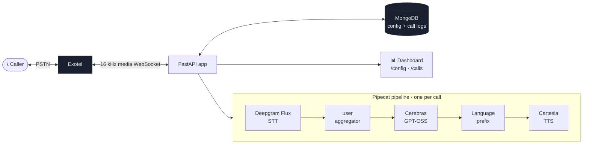

# 🎙️ VoiceAgent — Low-Latency Multilingual Phone Agent (V3)

An open-ended, **Hindi + English (Hinglish)** voice agent that talks to callers over a real phone line.
It pairs a streaming media pipeline with aggressive turn-taking, in-call memory, and an
optional speculative-LLM path to feel **snappy** on a normal phone call — then records a deep
per-turn metrics trail so every millisecond of latency is accountable.

```
📞  Exotel  ⇄  FastAPI / Pipecat  ⇄  Deepgram Flux (STT)  →  Cerebras GPT-OSS (LLM)  →  Cartesia (TTS)
                     │
                     └─►  MongoDB (config + call logs)  +  Web dashboard (/config, /calls)
```

> **Status:** working prototype, validated on live Exotel calls. Single-call scope, MongoDB-backed,
> 16 kHz fixed transport. See [docs/decisions/](docs/decisions/) for the architecture decisions (ADRs).

---

## ✨ What makes it interesting

| Capability | One-liner | Deep dive |
|---|---|---|
| **LLM-led language** | The model prefixes each reply with `<en>`/`<hi>`; code strips it and switches Cartesia's voice language per turn — no regex language router. | [ARCHITECTURE](docs/ARCHITECTURE.md) |
| **Low perceived latency** | ~0.5–0.65 s from your last word to the bot's first audio. Most of the "wall-clock" wait is *endpointing* (deciding you're done), which overlaps your natural pause. | [LATENCY](docs/LATENCY.md) |
| **Honest metrics** | Every turn is decomposed into VAD → EOT → commit → LLM → TTS spans. Two headline numbers: **responsiveness** (felt) vs **total** (physical). | [METRICS](docs/METRICS.md) |
| **In-call memory** | Recent window + pinned facts + a running summary + lexical recall, all under a token budget — no extra LLM call. | [MEMORY](docs/MEMORY.md) |
| **Speculative LLM** | *(off by default)* Drafts the reply during the endpointing tail on an EagerEOT and releases it at end-of-turn, hiding the wait. | [SPECULATION](docs/SPECULATION.md) |
| **Runtime-tunable** | All STT/LLM/TTS/memory/prompt tuning lives in MongoDB, editable live at `/config`; only secrets live in `.env`. | [CONFIGURATION](docs/CONFIGURATION.md) |

---

## 🗺️ How a call flows



The bot **speaks first** (an LLM-generated greeting), then each user turn is driven natively by
Deepgram Flux end-of-turn events. The full per-call lifecycle and the exact processor order are in
[docs/ARCHITECTURE.md](docs/ARCHITECTURE.md).

---

## 🧱 Tech stack

| Layer | Choice | Notes |
|---|---|---|
| Telephony | **Exotel** Voicebot Applet | Bidirectional 16 kHz media over WebSocket ([ADR-001](docs/decisions/ADR_001_SAMPLE_RATE_16000.md)) |
| Media pipeline | **Pipecat** 1.2.x | One `Pipeline` + `PipelineTask` per call |
| STT | **Deepgram Flux** (`flux-general-multi`) | Native turn-taking (StartOfTurn / EagerEOT / EndOfTurn), `en`+`hi` hints |
| LLM | **Cerebras** `gpt-oss-120b` | OpenAI-compatible, streaming, short replies (`max_tokens=160`) |
| TTS | **Cartesia** `sonic` | Sentence-streaming, per-turn language switch |
| Web / API | **FastAPI** | `/telephony/*` (calls) + `/config`, `/calls` (dashboard) |
| Persistence | **MongoDB** | Runtime config + per-call logs (required at startup) |

---

## 🚀 Quickstart

> Full step-by-step setup + live-call validation is in **[docs/RUNBOOK.md](docs/RUNBOOK.md)**.

```bash
# 1. Install (Python 3.11+)
python -m venv .venv && . .venv/Scripts/activate     # Windows: .venv\Scripts\activate
pip install -e .

# 2. Secrets only (tuning lives in Mongo, not here)
cp .env.example .env        # fill Deepgram / Cartesia / Cerebras / Exotel keys + MONGO_URI

# 3. Start MongoDB (required), then the app
python -m uvicorn main:app --host 127.0.0.1 --port 8000

# 4. Expose for Exotel + point the Voicebot Applet at https://<ngrok>/telephony/webhook
ngrok http 8000

# 5. Open the dashboard
#    http://127.0.0.1:8000/config   → tune STT/LLM/TTS/memory/prompts, place an outbound call
#    http://127.0.0.1:8000/calls    → per-call latency + transcript + metrics
```

Run the test suite with `pytest` (logic only — a real Exotel call is the only proof of voice behavior).

---

## 📚 Documentation

| Doc | What's inside |
|---|---|
| **[ARCHITECTURE](docs/ARCHITECTURE.md)** | Components, the exact 11-stage pipeline order & *why*, the full call lifecycle (inbound + outbound), frame flow. |
| **[LATENCY](docs/LATENCY.md)** | The headline story: endpointing vs pipeline budget, **responsiveness vs total**, and every latency-cutting technique. |
| **[METRICS](docs/METRICS.md)** | The per-turn record, all timing anchors, the call-outcome taxonomy, and how the dashboard renders it. |
| **[SPECULATION](docs/SPECULATION.md)** | EagerEOT telemetry (Stage 1) + the speculative-draft LLM gate (Stage 2). |
| **[MEMORY](docs/MEMORY.md)** | Recent window, pinned facts, running summary, lexical recall, and the token budget. |
| **[CONFIGURATION](docs/CONFIGURATION.md)** | Every runtime-config knob (with defaults & effect), the per-call snapshot, and env settings. |
| **[TELEPHONY](docs/TELEPHONY.md)** | Exotel transport, inbound vs outbound, the greeting flow, and fail-closed behavior. |
| **[RUNBOOK](docs/RUNBOOK.md)** | Local run + live-call validation checklist. |
| **[decisions/](docs/decisions/)** | Accepted architecture decisions (ADRs). |

New here? Read **ARCHITECTURE → LATENCY → METRICS** in that order.

---

## 📂 Repository layout

```
app/
  routers/        telephony.py (Exotel WS + webhook), dashboard.py (/config, /calls)
  services/       pipecat_pipeline.py (assembly), call_metrics.py (observer),
                  memory.py, speculation_controller.py, language_prefix.py,
                  deferred_flux_stt.py, turn_collector.py, transport_factory.py, ...
  models/         runtime_config_models.py (config schema), schemas.py (persistence)
  utils/          metrics_logger.py (call finalization)
  runtime.py      in-process session registry + config snapshot
  config.py       env Settings
main.py           FastAPI app + lifespan (DB, config seed, VAD warmup)
templates/        server-rendered dashboard (Jinja2)
docs/             this documentation set
tests/            pytest suite (logic, not telephony)
```
