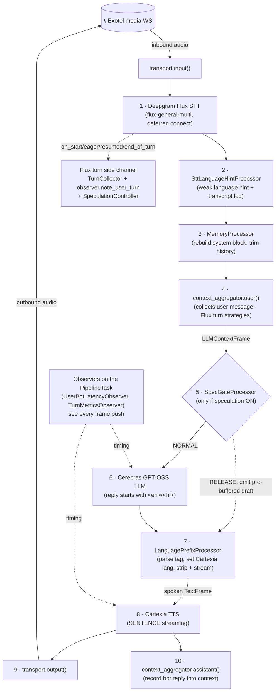
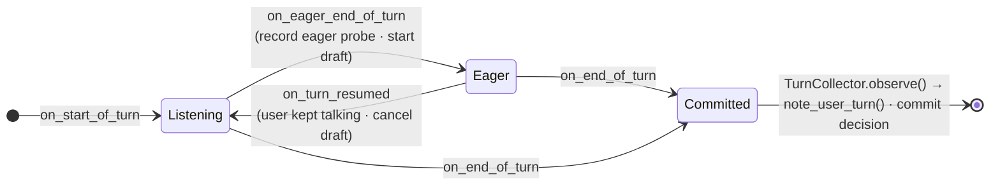

# Architecture

How the system is put together: the components, the per-call Pipecat pipeline, the exact processor
order (and *why* it's ordered that way), and the full lifecycle of a call from WebSocket connect to
finalize.

> **Companion docs:** [LATENCY](LATENCY.md) (timing), [METRICS](METRICS.md) (the observer & records),
> [TELEPHONY](TELEPHONY.md) (Exotel transport & call setup), [CONFIGURATION](CONFIGURATION.md) (knobs).

---

## 1. Design principles

A few decisions shape everything else (see [decisions/](decisions/) for the ADRs):

- **The pipeline is not the brain** ([ADR-003](decisions/ADR_003_PIPELINE_IS_NOT_BRAIN.md)). Pipecat
  only moves audio/STT/LLM/TTS frames. Conversation logic (memory, language routing, turn commitment,
  metrics) lives in dedicated processors and side channels with explicit hand-off contracts.
- **Config is data, not code.** All tuning (STT/LLM/TTS/memory/prompts) lives in MongoDB, is editable
  live at `/config`, and is **snapshotted immutably per call**. Only secrets live in `.env`
  ([ADR-002](decisions/ADR_002_ENV_SECRETS_ONLY.md)). See [CONFIGURATION](CONFIGURATION.md).
- **Fixed 16 kHz transport** ([ADR-001](decisions/ADR_001_SAMPLE_RATE_16000.md)) — the Exotel
  serializer and the whole pipeline run at 16 000 Hz; sample rate is not configurable.
- **Observers, not processors, for cross-stage timing.** Latency that spans STT→LLM→TTS is measured
  by `BaseObserver`s attached to the `PipelineTask`, because an observer sees *every* frame push
  regardless of where it happens in the graph.
- **Runtime state is JSON-safe and in-process.** `app/runtime.py` holds `ACTIVE_SESSIONS` — never live
  Pipecat/provider objects, only serializable data.

---

## 2. Components at a glance

| Component | File | Responsibility |
|---|---|---|
| **App + lifespan** | `main.py` | FastAPI app; on startup: logging, **MongoDB (required)**, seed runtime config, local VAD warmup, optional Exotel outbound client. |
| **Telephony route** | `app/routers/telephony.py` | `GET /telephony/webhook` (returns the WS URL) and `WS /telephony/exotel` (the media stream → pipeline → finalize). |
| **Pipeline assembly** | `app/services/pipecat_pipeline.py` | Builds every service/processor, defines the **processor order**, wires the Flux turn side channel, schedules the greeting, runs the `PipelineRunner`. |
| **Transport** | `app/services/transport_factory.py` | Exotel `ExotelFrameSerializer` + `FastAPIWebsocketTransport` at 16 kHz in/out. |
| **STT** | `app/services/deferred_flux_stt.py` | Deepgram Flux (`flux-general-multi`) with a background-connect subclass so the greeting isn't blocked. |
| **Turn commitment** | `app/services/turn_collector.py` | Turns raw Flux end-of-turn events into exactly one committed user turn (dedup, empty/greeting suppression). |
| **Language routing** | `app/services/language_prefix.py`, `language.py` | Parses the LLM's `<en>`/`<hi>` tag, switches Cartesia language, strips the tag, streams spoken text. |
| **Memory** | `app/services/memory.py` + `MemoryProcessor` | Rebuilds the system prompt per turn (recent window + facts + summary + recall). |
| **Speculation** *(opt-in)* | `app/services/speculation_controller.py` | EagerEOT draft + gate that can replace the normal LLM call. |
| **Metrics observer** | `app/services/call_metrics.py` | One per-turn record with the full latency decomposition. |
| **Finalize/persist** | `app/utils/metrics_logger.py`, `app/database.py` | Builds the `CallLog` and writes it to MongoDB. |
| **Dashboard** | `app/routers/dashboard.py`, `templates/` | `/config` (live tuning + outbound dial) and `/calls` (per-call metrics). |
| **Session registry** | `app/runtime.py` | `ACTIVE_SESSIONS`, `PENDING_OUTBOUND_CALLS`, config snapshot helpers. |

---

## 3. The pipeline (one per call)

Each call is a single Pipecat `Pipeline` of **11 stages** (12 with speculation on), assembled in
`_build_pipeline_processors`. The order is load-bearing.



### Why this order

| Stage | Placement rationale |
|---|---|
| **Flux STT (1)** first | The user turn is *data-driven* by transcription — nothing downstream can act until text exists. |
| **SttLanguageHint (2)** after STT | Observes every interim/final transcript to record a *weak* detected-language hint. It does **not** decide language — that's the LLM's `<en>`/`<hi>` tag. |
| **MemoryProcessor (3)** before the user aggregator | On a finalized transcript it rebuilds the system message and trims history **while the current user message is not yet in context**, so the prompt is assembled cleanly. |
| **User aggregator (4)** | Appends the user message; on Flux turn-stop it emits the `LLMContextFrame` that triggers the LLM. |
| **SpecGate (5)** between aggregator and LLM | It must sit exactly here to intercept the `LLMContextFrame` and *swallow* it on a draft hit (so the real LLM never runs). Absent when speculation is off → list is byte-identical to baseline. |
| **LLM (6)** | Cerebras streams `LLMFullResponseStart` → `LLMTextFrame`s (starting with the tag) → `LLMFullResponseEnd`. |
| **LanguagePrefix (7)** between LLM and TTS | Must parse and **strip the tag before TTS**, because TTS consumes the input `TextFrame` and echoes its own `TTSTextFrame` into the assistant context — stripping here keeps the tag out of **both** the audio and the saved context. |
| **TTS (8) → output (9) → assistant aggregator (10)** | Standard Pipecat tail; the assistant aggregator is last so the reply lands in context *after* it's spoken. |

---

## 4. The Flux turn side channel

The committed user turn is **not** produced by the observers or `TurnCollector` — it is driven
natively by Deepgram Flux end-of-turn, which flushes the user aggregator. The side channel only rides
those events for commitment, transcript, metrics, and speculation:



- **`on_end_of_turn`** snapshots+clears the eager probe, lets the (optional) `SpeculationController`
  commit its release/normal decision, runs `TurnCollector.observe()` to get exactly one committed
  turn, appends the user transcript event, and calls `metrics_observer.note_user_turn()` (which
  *queues* a pending turn record).
- **`on_start_of_turn` / `on_eager_end_of_turn` / `on_turn_resumed`** feed the Stage-1 eager probe and
  drive the Stage-2 controller. They are inert unless `eager_eot_threshold` is configured.
- Provider **`on_error`** handlers are registered for STT/TTS/LLM, so a provider `ErrorFrame` is
  attributed to the open turn with a stage label (`tts_provider_error`, etc.).

---

## 5. The greeting (the bot speaks first)

The opening line is the **only** manually queued speech, and it bypasses the LLM + LanguagePrefix
entirely:

- `_schedule_opening_greeting` registers an **`on_client_connected`** handler. When the transport
  signals the media path is up, it waits a short **settle delay** (`greeting_settle_delay_ms`, default
  500 ms) and queues a `TTSSpeakFrame(greeting)`.
- It fires **autonomously** — it never waits for the caller to speak.
- The settle delay is a correctness floor: speaking *before* the carrier media path is ready lets
  Exotel silently drop the first audio.
- Any leaked `<en>`/`<hi>` tag is stripped first (the greeting skips the parser).
- **Outbound fail-closed:** an outbound call whose generated greeting was lost (process restart, TTL,
  multi-worker) returns `completed=False` rather than speaking the canned *inbound* greeting. See
  [TELEPHONY](TELEPHONY.md).

---

## 6. Observers

Both observers are attached to the **`PipelineTask`** (`observers=[...]`), **not** inserted into the
processor chain:

- **`TurnMetricsObserver`** ([call_metrics.py](../app/services/call_metrics.py)) — builds one record
  per user→bot turn. It fills timestamps from frames (`BotStartedSpeaking` → first audio,
  `LLMFullResponseStart` → response start, `LLMTextFrame` → first token, `TTSStarted` → TTS start,
  VAD/UserStopped → stop anchors) and merges side-channel `note_*` calls (`note_user_turn`,
  `note_assistant_text`, `note_language`, `note_error`, `note_memory_timing`). Overlapping turns are
  **merged, never overwritten**. Full detail in [METRICS](METRICS.md).
- **`UserBotLatencyObserver`** (Pipecat built-in) — reports first-bot-speech latency once per call.

> **Why an observer and not a processor?** A processor only sees frames that pass through its position.
> An observer sees every frame push anywhere in the graph — the only way to time a path that spans STT,
> LLM, and TTS simultaneously.

---

## 7. Full call lifecycle

```mermaid
sequenceDiagram
    autonumber
    participant Exotel
    participant Route as /telephony/exotel
    participant Transport as WebsocketTransport
    participant Pipe as Pipeline
    participant Flux as Deepgram Flux
    participant Obs as TurnMetricsObserver
    participant Mongo as MongoDB

    Exotel->>Route: GET /webhook → returns wss URL (+direction)
    Exotel->>Route: open WS /telephony/exotel
    Route->>Route: accept · resolve call_sid/stream_sid · create_session
    Route->>Transport: build_exotel_transport(ws, ids)
    Route->>Pipe: run_pipeline → PipelineRunner.run(task)
    Transport->>Pipe: StartFrame (deferred Flux connects in background)
    Transport-->>Route: on_client_connected
    Route->>Pipe: queue TTSSpeakFrame(greeting) after settle delay
    Pipe->>Exotel: 🔊 greeting audio (caller muted until first bot done)

    rect rgb(27,32,48)
    Note over Exotel,Obs: one user turn
    Exotel->>Transport: caller audio
    Transport->>Flux: audio frames
    Flux->>Pipe: TranscriptionFrame (final)
    Flux-->>Route: on_end_of_turn(transcript)
    Route->>Obs: note_user_turn (queue pending)
    Pipe->>Pipe: user aggregator emits LLMContextFrame
    Pipe->>Pipe: LLM streams <en>/<hi> + tokens
    Pipe->>Pipe: LanguagePrefix sets language · strips tag
    Obs->>Obs: note_assistant_text (authoritative "LLM done")
    Pipe->>Exotel: 🔊 TTS audio (BotStartedSpeaking → first_audio)
    Obs->>Obs: _try_finalize → emit TurnRecord
    end

    Exotel-->>Transport: WS close (hang up)
    Transport-->>Route: on_client_disconnected → task.cancel()
    Pipe->>Route: PipelineExecutionResult(completed, disconnected)
    Route->>Mongo: finalize_call_log + persist
    Route->>Route: delete_session (finally)
```



**Teardown nuance:** a disconnect *during* the active pipeline is handled by the transport's
`on_client_disconnected` callback (cancel → runner unwinds → normal return). The route's
`WebSocketDisconnect` branch only covers disconnects during *pre-pipeline* identity/session setup.

---

## 8. Process startup (`main.py` lifespan)

In order, on app start:

1. `setup_logging` — structured logging.
2. `init_database` — **MongoDB is required**; the app fails clearly at startup if it's unreachable
   (rather than serving calls with no runtime config).
3. `seed_runtime_config_if_missing` — seeds the default `runtime_config` document into the process
   cache.
4. `run_local_warmup` — instantiates-and-discards a `SileroVADAnalyzer` so the first real call doesn't
   pay the onnxruntime/model-load cold start (local only — no provider sockets).
5. Attach an optional `ExotelOutboundClient` for placing outbound calls from `/config`.

---

## 9. Key data shapes

```python
# Per-call immutable config snapshot (runtime.py)
ConfigSnapshot = { runtime_config, SYSTEM_PROMPT, GREETING_PROMPT, LLM_MODEL, LLM_TEMPERATURE,
                   TTS_VOICE_ID, TTS_MODEL, INITIAL_GREETING_FALLBACK_TEXT, SAMPLE_RATE=16000 }

# In-process session (runtime.py — JSON-safe only, never live objects)
RuntimeSession = { call_sid, stream_sid, metrics, transcript, first_latency, config_snapshot }

# Pipeline outcome returned to the route (pipecat_pipeline.py)
PipelineExecutionResult = { completed: bool, error: str | None, disconnected: bool }
```

The per-turn `TurnRecord` (the heart of observability) is documented in **[METRICS](METRICS.md)**.
