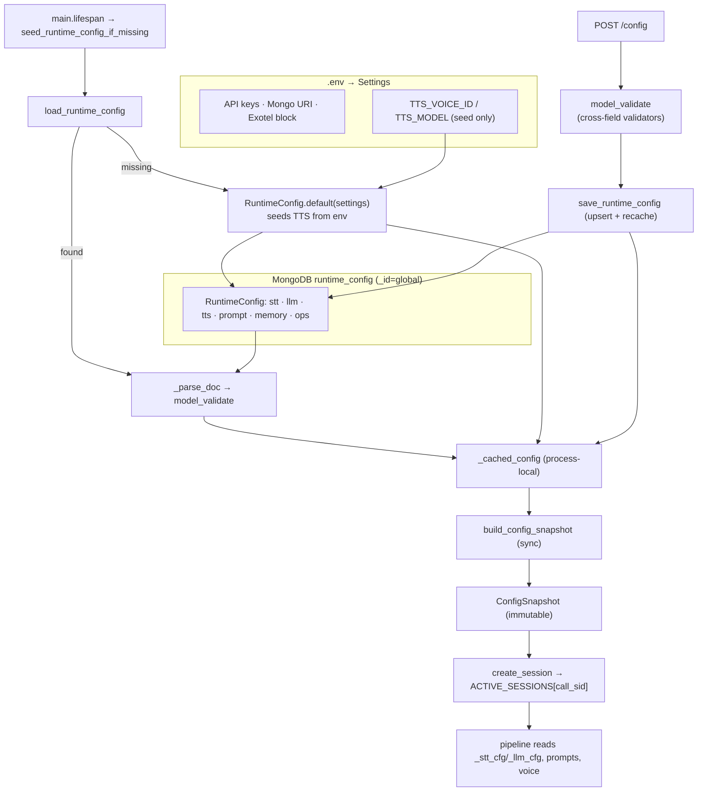
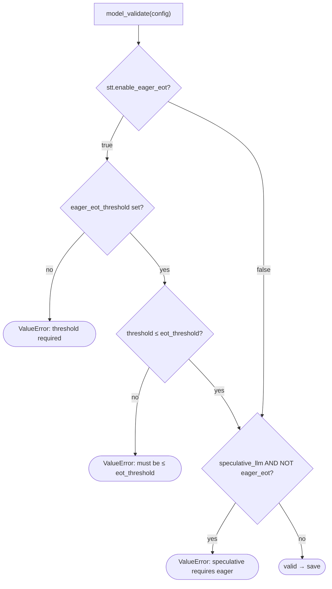

# Configuration

How the system is configured: a strict **two-tier** split between secrets (env) and behavior (MongoDB),
the immutable per-call snapshot, and every tunable knob.

> **Principle ([ADR-002](decisions/ADR_002_ENV_SECRETS_ONLY.md)):** only secrets/infra live in `.env`.
> *All* behavior/tuning lives in one MongoDB document, editable live at `/config`, and is **snapshotted
> per call** so a mid-call save never affects calls in flight.

---

## 1. Two tiers

| Tier | Where | Holds | Editable |
|---|---|---|---|
| **Secrets / infra** | `.env` → `Settings` ([config.py](../app/config.py)) | API keys, Mongo URI, the Exotel block, ngrok URL, greeting/timeout knobs | edit `.env`, restart |
| **Behavior / tuning** | MongoDB `runtime_config` doc (`_id="global"`) → `RuntimeConfig` | STT / LLM / TTS / prompts / memory / ops | **live, at `/config`** |

---

## 2. Config flow

The cache exists so the **inbound** path can build a snapshot **synchronously** (no `await`). The
**outbound** path instead loads config *live* and refuses to dial on failure (see [TELEPHONY](TELEPHONY.md)).

---

## 3. `RuntimeConfig` — every behavior knob

### STT (`stt`)
| Field | Default | Effect |
|---|---|---|
| `model` | `flux-general-multi` | Deepgram Flux multilingual model |
| `language_hints` | `["en","hi"]` | Flux hints (multilingual model only) |
| `eot_threshold` | `0.65` | Flux end-of-turn confidence |
| `eot_timeout_ms` | `700` | Flux endpointing timeout |
| `defer_connect_on_start` | `true` | Background-connect Flux so the greeting isn't blocked |
| `turn_stop_timeout_ms` | `500` (100–1000) | **Post-STT debounce — the fixed per-turn pre-LLM delay** ([LATENCY](LATENCY.md)) |
| `enable_eager_eot` | `false` | Stage-1 EagerEOT telemetry ([SPECULATION](SPECULATION.md)) |
| `eager_eot_threshold` | `none` (0.3–0.9) | Required when eager on; **must be ≤ `eot_threshold`** |

### LLM (`llm`)
| Field | Default | Effect |
|---|---|---|
| `provider` | `cerebras` | fixed |
| `model` | `gpt-oss-120b` | |
| `temperature` | `0.7` | |
| `max_tokens` | `160` | Reply length cap → bounds `llm_total_ms`, faster TTS-complete |
| `request_timeout_seconds` | `10.0` | Per-request timeout; also bounds outbound greeting generation |
| `enable_speculative_llm` | `false` | Stage-2 speculative draft. **Requires `enable_eager_eot`** |

### TTS (`tts`)
| Field | Default | Effect |
|---|---|---|
| `provider` | `cartesia` | fixed |
| `model` | `sonic-3.5` | |
| `voice_id` | `""` | seeded from `TTS_VOICE_ID` env on first config seed |
| `language_mode` | `per_turn` | `per_turn` switches voice language each turn from the `<en>`/`<hi>` tag |

### Prompts (`prompt`)
| Field | Default | Effect |
|---|---|---|
| `system_prompt` | persona default | The editable persona/behavior. The `<en>`/`<hi>` protocol + factual guardrail are injected by **code**, before the persona, so they survive any persona edit. |
| `greeting_prompt` | default | Used to generate the outbound opening line |

### Memory (`memory`)
See [MEMORY](MEMORY.md) §7 for the full table. Defaults: `recent_turn_pairs=6`,
`max_pinned_facts=12`, `max_recall_snippets=2`, `recall_min_overlap=2`, `max_memory_block_tokens=600`,
`enable_running_summary_after_turn=10`, `summary_update_every_turns=5`, `max_summary_tokens=250`.

### Ops (`ops`)
| Field | Default | Effect |
|---|---|---|
| `debug_log_level` | `INFO` | log verbosity |

---

## 4. Validators (rejected at save time)

Incoherent configs are rejected when you save — not silently ignored:

Both validators are no-ops when the features are off, so all existing stored configs still validate.

---

## 5. Per-call snapshot & session registry

- **`ConfigSnapshot`** — a plain dict frozen from the cached config at session creation (the full
  `runtime_config` plus a few flattened legacy keys like `SYSTEM_PROMPT`, `TTS_VOICE_ID`,
  `INITIAL_GREETING_FALLBACK_TEXT`, `SAMPLE_RATE=16000`). Immutability is by convention: a mid-call save
  updates the cache + Mongo but **does not** mutate snapshots already frozen onto live sessions.
- **`ACTIVE_SESSIONS`** / **`PENDING_OUTBOUND_CALLS`** — plain in-process dicts in
  [runtime.py](../app/runtime.py). They hold **only JSON-serializable state** (every setter round-trips
  through `json.loads(json.dumps(...))`) — never live Pipecat/provider objects.

> ⚠️ These registries are **process-local** — not shared across workers/replicas. A multi-process deploy
> would not see each other's sessions (this is exactly why outbound detection also uses the carrier
> `Direction` — see [TELEPHONY](TELEPHONY.md)). MongoDB is **required**; the app fails clearly at startup
> if it's unreachable.

---

## 6. `.env` Settings (secrets / infra)

| Key | Default | Purpose |
|---|---|---|
| `DEEPGRAM_API_KEY` / `CEREBRAS_API_KEY` / `CARTESIA_API_KEY` | — | provider auth |
| `MONGO_URI` / `MONGO_DB_NAME` | — | **required** — config + call logs |
| `EXOTEL_ACCOUNT_SID` / `_API_KEY` / `_API_TOKEN` / `_VIRTUAL_NUMBER` / `_FLOW_ID` | — | outbound dialing (missing → inbound-only) |
| `EXOTEL_SUBDOMAIN` | `api.in.exotel.com` | REST + ExoML domain |
| `PUBLIC_NGROK_URL` | — | base for the `wss://…/telephony/exotel` URL |
| `TTS_VOICE_ID` / `TTS_MODEL` | `""` / `sonic-3.5` | **seed only** for the default config |
| `GREETING_SETTLE_DELAY_MS` | `500` | carrier-settle delay before the greeting |
| `OUTBOUND_GREETING_START_DELAY_MS` | `0` | outbound settle override |
| `PENDING_OUTBOUND_TTL_SECS` | `600` | eviction age for pending outbound contexts |
| `HOST` / `PORT` | `127.0.0.1` / `8000` | server bind |

`Settings` uses `extra="ignore"` (unknown env keys are dropped); required keys without defaults raise at
construction. `V1_SAMPLE_RATE = 16000` is a constant, not a knob ([ADR-001](decisions/ADR_001_SAMPLE_RATE_16000.md)).

---

## 7. Editing config

`POST /config` runs `_parse_config_form` → `RuntimeConfig.model_validate` (raises on validator failure) →
`save_runtime_config` (upsert + recache). The form surfaces the **editable subset**; fields not in the
form (e.g. `version`, `max_pinned_facts`, `max_summary_tokens`) are carried over from the existing config
and persist but aren't UI-editable. A failed config load renders the page from the cached-or-default
config with a visible "NOT saved" warning.

> See **[RUNBOOK](RUNBOOK.md)** for the operational walk-through of `/config` and placing a call.
