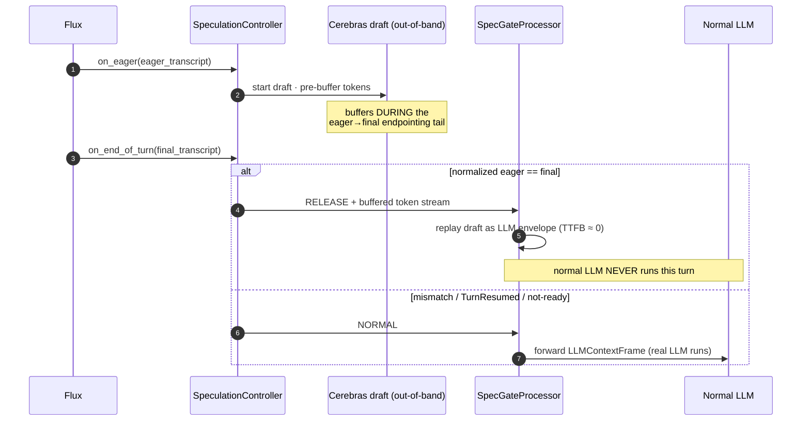

# Latency

Why the bot feels **snappy** even though the wall-clock "user-stop → first-audio" reads ~1.4 s — and
every technique the codebase uses to keep perceived latency low.

> **TL;DR.** Of a typical ~1.4 s turn, only **~250 ms is the bot actually working** (LLM + TTS). The
> other ~1.1 s is **endpointing** — the system waiting to be sure you finished talking — which overlaps
> the natural pause you leave after a sentence, so you don't perceive it as the bot being slow. The
> number you *feel* is **responsiveness ≈ 0.5–0.65 s**.

---

## 1. Two latencies, deliberately distinguished

The metrics observer ([call_metrics.py](../app/services/call_metrics.py)) computes **two** numbers for
every turn, anchored on different events:

| Metric | Anchored at | Measures | Typical |
|---|---|---|---|
| **Total** (headline) | **VAD true-silence** = `VADUserStoppedSpeakingFrame.timestamp − stop_secs` | true acoustic silence → first audio. **Includes the whole endpointing budget.** | **~1.4 s** |
| **Responsiveness** | the user's **last-word / turn-release** instant | last word → first audio. The genuinely controllable backend. | **~0.5–0.65 s** |

Both are real; they answer different questions. **Total** is the honest physical wait. **Responsiveness**
is what the caller perceives, because the gap between the two (~700–900 ms of endpointing) falls inside
the natural turn-taking pause humans leave after speaking.

> The dashboard shows **responsiveness** as the headline and **total** as a muted secondary — using the
> *median*, because a few slow-LLM turns skew the mean. See [METRICS](METRICS.md).

---

## 2. Anatomy of one turn

A turn breaks into a long **endpointing** prefix (waits) and a short **pipeline** tail (work). The
observer emits a delta for each span so a slow turn is localized to exactly one stage.

```mermaid
gantt
    title One turn — endpointing (waiting) vs pipeline (working)
    dateFormat X
    axisFormat %L ms
    section Endpointing (the felt "wait", ~0.9–1.2 s)
    VAD silence window — stop_secs 0.2 s          :a1, 0, 200
    Flux EOT detect — thr 0.65 / timeout ≤0.7 s   :a2, after a1, 450
    Turn-stop debounce 0.5 s — fixed pre-LLM      :a3, after a2, 500
    section Pipeline (the "work", ~0.25–0.5 s)
    Memory governance — cap 600 tok               :b1, after a3, 30
    LLM TTFB — Cerebras, max_tokens 160           :b2, after b1, 200
    LLM→TTS handoff — streaming ≈ 0               :b3, after b2, 10
    TTS first-sentence audio — Cartesia           :b4, after b2, 200
    section Anchors
    VAD silence  (TOTAL starts here)              :milestone, m1, 0, 0
    Commit       (RESPONSIVENESS starts here)     :milestone, m2, 1150, 0
    First audio                                   :milestone, m3, 1400, 0
```

### The exact spans (per-turn record fields)

| Span | Field | What it is |
|---|---|---|
| User-stop → EOT | `user_stop_to_eot_ms` | **Endpointing:** VAD silence + Flux EOT detection |
| EOT → commit | `eot_to_turn_committed_ms` | Tiny — same handler stamps both |
| Commit → LLM start | `turn_committed_to_llm_start_ms` | The queue before the LLM, **dominated by the turn-stop debounce** |
| LLM start → first token | `llm_ttfb_ms` | LLM time-to-first-token |
| LLM start → done | `llm_total_ms` | Full LLM stream |
| LLM done → TTS start | `llm_end_to_tts_start_ms` | Hand-off — **≈ 0** thanks to streaming |
| TTS start → first audio | `tts_first_audio_ms` | Cartesia first-sentence audio |

The first-audio anchor is the `BotStartedSpeakingFrame`.

---

## 3. The endpointing budget — the bulk of the wait

Endpointing is four serial waits *before the LLM can even start*:

| # | Wait | Knob | Default | Notes |
|---|---|---|---|---|
| ① | VAD silence window | *(Pipecat default, not config)* | `stop_secs = 0.2 s` | Silence the Silero VAD must observe before declaring "stopped". Subtracted back out to get the honest anchor. |
| ② | Flux end-of-turn detect | `stt.eot_threshold` / `stt.eot_timeout_ms` | `0.65` / `700 ms` | Flux fires when EOT confidence crosses `0.65`, or after `eot_timeout_ms`. Lower = snappier but more mid-sentence truncation. |
| ③ | Pipecat turn-stop debounce | `stt.turn_stop_timeout_ms` | `500 ms` | **The single largest tunable lever.** See the gotcha below. |

> ⚠️ **`turn_stop_timeout_ms` is a *fixed* per-turn delay, not an upper bound.** Because
> `UserStoppedSpeakingFrame` (a SystemFrame) overtakes the queued finalized `TranscriptionFrame`, the
> turn strategy's "immediate" trigger path always misses — so this 500 ms timeout is what actually fires
> the LLM *every* turn. Lowering it directly cuts perceived latency; too low risks splitting a turn whose
> final transcript arrives in pieces. It shows up as `turn_committed_to_llm_start_ms`.

> 🧩 **Don't conflate the two endpointing knobs.** `eot_timeout_ms` (700 ms) is *Deepgram Flux*
> endpointing; `turn_stop_timeout_ms` (500 ms) is the *Pipecat post-STT* debounce. They are different
> waits at different layers.

---

## 4. The pipeline budget — the responsive part

After the turn commits, the actual work is short:

- **Memory governance** runs synchronously before the user aggregator, rebuilding the system block and
  trimming history. It's deliberately cheap: the running summary is refreshed **post-turn** (off the hot
  path), and the dynamic memory block is capped at `max_memory_block_tokens = 600` precisely so the
  per-turn prompt can't inflate LLM TTFB. Its cost is measured (`memory_processor_duration_ms`). See
  [MEMORY](MEMORY.md).
- **LLM TTFB** — Cerebras `gpt-oss-120b`, `max_tokens = 160`. Low max-tokens both bounds `llm_total_ms`
  and matches the 1–2-sentence phone persona, so replies are short and TTS finishes sooner.
- **TTS first audio** — Cartesia in **sentence-streaming** mode (`max_buffer_delay_ms = 0`) starts on
  the first complete sentence, not the whole reply.

---

## 5. Latency-cutting techniques (what the code actually does)

### 5.1 Streaming LLM → TTS overlap
The `LanguagePrefixProcessor` forwards LLM token frames to Cartesia **as they arrive** — it only buffers
the first few characters to read the `<en>`/`<hi>` tag, sets the language, strips the tag, and streams the
rest with **no full-response buffering**. With Cartesia in `SENTENCE` mode + `max_buffer_delay_ms=0`, TTS
starts on the first sentence. Result: `llm_end_to_tts_start_ms ≈ 0`, and audio begins long before the
160-token reply finishes. (The language switch is also a no-op when unchanged, avoiding per-turn TTS
context churn.)

### 5.2 Short replies
`max_tokens = 160` + a persona that says "usually 1–2 sentences" keeps `llm_total_ms` small and lets TTS
complete quickly.

### 5.3 Deferred Flux connect (greeting head-start)
The Flux websocket takes ~1 s to connect, and Pipecat only forwards the `StartFrame` (which the greeting
rides behind) *after* the STT service finishes starting. The
[`DeferredConnectDeepgramFluxSTTService`](../app/services/deferred_flux_stt.py) kicks the connect off as a
**background task** so the greeting flows straight to TTS. It's safe because the caller is muted through
the greeting. `defer_connect_on_start = True` by default. This helps **greeting** latency only — STT must
be connected by the first user turn (tracked via `stt_ready_before_user_turn`).

### 5.4 Local VAD warmup
[`warmup.py`](../app/services/warmup.py) instantiates-and-discards a `SileroVADAnalyzer` at startup so the
first real call doesn't pay the onnxruntime session + model-load cold start. Strictly local — no provider
sockets, no billable synthesis.

### 5.5 EagerEOT + speculative draft *(off by default — the tail-hider)*
The endpointing budget can't be cut below the truncation-risk floor. So the most aggressive option
*hides* it instead: on a Flux **EagerEndOfTurn** (fired before the final EOT), an out-of-band Cerebras
**draft** starts generating the reply and pre-buffers tokens *during* the eager→final endpointing tail. At
EndOfTurn, if the eager transcript matches the final one, the gate **releases the pre-buffered draft in
place of the normal LLM** — so `llm_ttfb_ms ≈ 0` and the wait is hidden behind tokens that already exist.

Full mechanics, invariants, and the gate state machine are in **[SPECULATION](SPECULATION.md)**. When
disabled (the default), the gate isn't even inserted and the pipeline is byte-identical to baseline — so
all default latency numbers reflect the non-speculative path.

### 5.6 Autonomous greeting (a correctness floor, not waste)
The greeting fires on `on_client_connected` (not on caller speech) after `greeting_settle_delay_ms` =
500 ms. The settle delay is required: audio produced before the carrier media path is up gets dropped by
Exotel and never heard.

---

## 6. Tuning cheat-sheet

| Want… | Change | Trade-off |
|---|---|---|
| Lower perceived latency | ↓ `stt.turn_stop_timeout_ms` (e.g. 500 → 300) | Too low splits turns whose transcript arrives in pieces |
| Snappier end-of-turn | ↓ `stt.eot_threshold` / `stt.eot_timeout_ms` | More mid-sentence truncation |
| Hide the endpointing tail | enable `stt.enable_eager_eot` + `llm.enable_speculative_llm` | Extra Cerebras load on miss turns; needs capacity ([SPECULATION](SPECULATION.md)) |
| Shorter replies / faster TTS-complete | ↓ `llm.max_tokens` | Truncated answers |
| Smaller prompt → lower TTFB | ↓ `memory.recent_turn_pairs` / `memory.max_memory_block_tokens` | Less context/recall |

All knobs, defaults, and ranges: **[CONFIGURATION](CONFIGURATION.md)**.

---

## 7. Measurement caveats (so you trust the numbers)

- **VAD anchor preferred, with a staleness guard.** The headline uses the VAD true-silence anchor; a stale
  anchor (older than 30 s vs EOT, or after EOT — e.g. a muted barge-in) is rejected. In unit tests (no VAD
  frame) it falls back to the later turn-release anchor, so test latencies look smaller than production.
- **`llm_response_started_at` is a frame-level proxy** stamped at `LLMFullResponseStartFrame`, which
  Pipecat pushes just *before* the real provider request — so `turn_committed_to_llm_start` slightly
  understates true request start. (Named `*_response_started_at`, not `*_request_started_at`, to be
  honest about this.)
- **On a released speculative turn, `llm_ttfb_ms ≈ 0`** (tokens were pre-buffered) — use
  `draft_headstart_ms` for speculative analysis instead.
- **Merged turns:** if you pause mid-thought and continue, the two sub-utterances merge. The *earliest*
  stop anchors the headline, but the *latest* commit is the true backend delay — the earliest-anchored
  value is inflated by your own pause, not by the bot.
- **Stage-1 `estimated_saved_ms` is an estimate**, not a realized saving — it assumes a draft's TTFB
  equals the normal TTFB; no draft is actually run in Stage 1.
