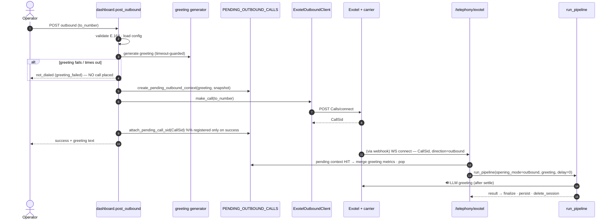
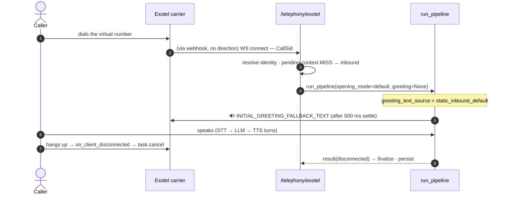
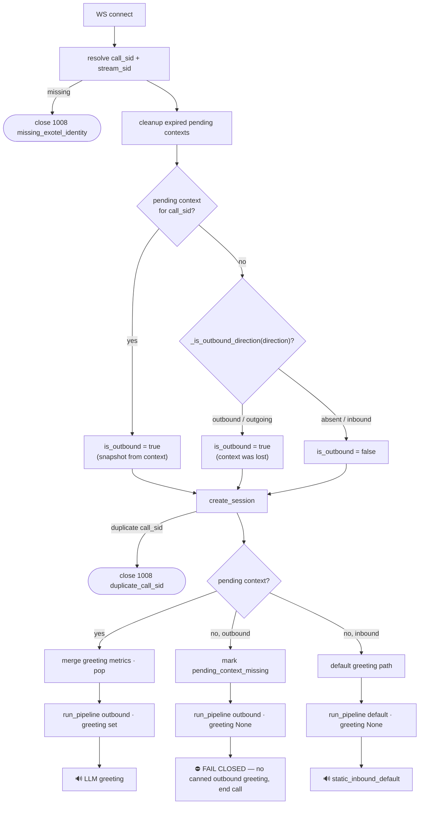

# Telephony (Exotel)

How calls connect: the Exotel webhook + media WebSocket, the **greeting-first** outbound flow, the
inbound flow, and the **fail-closed** guarantee that an outbound call never speaks a canned greeting.

> The whole transport is pinned to **16 kHz** end-to-end ([ADR-001](decisions/ADR_001_SAMPLE_RATE_16000.md)).

---

## 1. Two entry points

| Endpoint | Who calls it | What it does |
|---|---|---|
| `GET /telephony/webhook` | Exotel Voicebot Applet | Returns the media **WebSocket URL** (`wss://…/telephony/exotel?sample-rate=16000`), threading the carrier **`Direction`** onto it. |
| `WS /telephony/exotel` | Exotel media stream | Carries 16 kHz audio, drives the pipeline, owns session lifecycle + finalize/persist. |

The webhook hands out the URL; the WebSocket carries the call.

---

## 2. Outbound — greeting generated *before* dial

Outbound calls are placed from `/config`. The opening greeting is generated and validated **before**
Exotel is even dialed — if it fails, **no call is placed**:

Key invariants:
- **Greeting-first:** the LLM greeting is generated + validated before `make_call`. There is **no static
  fallback for outbound**.
- **Registered only on dial success:** `create_pending_outbound_context` returns an *unregistered* object;
  `attach_pending_call_sid` inserts it into the registry only after a successful dial — so a `make_call`
  failure leaves nothing to clean up.
- **Number roles are counter-intuitive:** in the Exotel v1 connect API the *customer's* number is `From`
  and the *virtual* number is `CallerId` — Exotel dials the customer leg first, then bridges to the flow.

---

## 3. Inbound — dialed-in, static greeting

Inbound calls have no pending context, so they use the static `INITIAL_GREETING_FALLBACK_TEXT` — which is
**legitimate** for inbound (and marked `greeting_text_source = static_inbound_default` so it's visible in
the dashboard).

---

## 4. The connect decision (outbound / inbound / fail-closed)

### The fail-closed guarantee

**An outbound call must never speak the canned inbound greeting.** Because the pending context lives in a
*process-local* dict, it can be lost (restart, TTL expiry, or a multi-worker deploy where the WS lands on a
different worker than the one that dialed). To survive that, the call is identified as outbound by **two
independent signals**:

1. the surviving **pending context**, or
2. the carrier **`Direction`** threaded onto the WS URL by the webhook.

`_is_outbound_direction` is intentionally **strict** (only `"outbound"`/`"outgoing"`; `false` for
`none`/inbound) so a normal inbound call — which legitimately has no pending context — is never
mis-flagged. When an outbound call is identified but its greeting is missing, `run_pipeline` returns
`completed=False` **before the runner even starts**, and the outcome derives to **`greeting_failed`** (not
`pipeline_error`). See [METRICS](METRICS.md) §5.

---

## 5. Identity & close codes

Identity (`call_sid`, `stream_sid`) is resolved first from the WS query string, then via Pipecat's
`parse_telephony_websocket`. Policy violations close the socket with **1008**:

| Reason | When |
|---|---|
| `missing_exotel_identity` | no `CallSid`/`StreamSid` resolvable |
| `unsupported_provider` | transport type isn't `exotel` |
| `duplicate_call_sid` | a session already exists for that call |

---

## 6. The `ExotelOutboundClient`

[exotel_client.py](../app/services/exotel_client.py):

- Validates the 5 required Exotel fields at construction (rejecting empty/placeholder values); if any are
  missing, `main.py` runs the server **inbound-only**.
- Builds the REST connect URL `https://{subdomain}/v1/Accounts/{sid}/Calls/connect` and derives the ExoML
  flow URL by swapping the first `api` → `my` in the subdomain.
- `make_call` POSTs `{From: customer, CallerId: virtual, Url: flow, CallType: "trans"}` and parses the
  `CallSid` from the XML response. Errors are returned as a typed `ExotelCallResult(success=False, error)`.

---

## 7. Finalize / persist boundary

The **WS route** — not `run_pipeline` — owns session creation, finalize, persist, and cleanup;
`run_pipeline` only returns a serializable `PipelineExecutionResult(completed, error, disconnected)`.

- **Normal completion** → persist in the try block.
- **Pre-pipeline disconnect** → `WebSocketDisconnect` persists a partial log (`completed=False,
  disconnected=True`).
- **In-pipeline disconnect** → handled by the transport's `on_client_disconnected` → `task.cancel`,
  surfacing as `completed=True, disconnected=True`.
- **Unexpected exception** → persist `completed=False`, then re-raise.
- `finally` always `delete_session` to evict from `ACTIVE_SESSIONS`.

> Disconnect is signalled **structurally** via the `disconnected` flag, never inferred from exception
> text — so a hang-up is never confused with a crash.

---

## 8. The 16 kHz contract

A single sample rate end-to-end: the WS URL (`?sample-rate=16000`), the `ExotelFrameSerializer`, the
transport (`audio_in/out_sample_rate`), STT, TTS, the Silero VAD, and `PipelineParams` are all pinned to
`V1_SAMPLE_RATE = 16000`. Not user-tunable ([ADR-001](decisions/ADR_001_SAMPLE_RATE_16000.md)).
